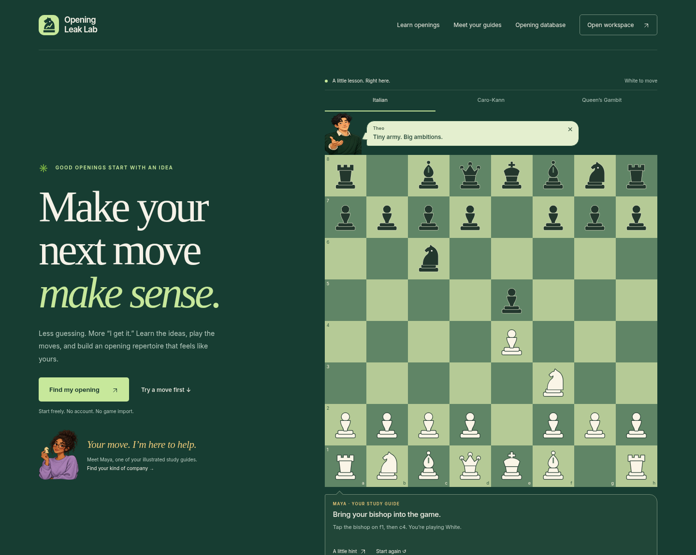
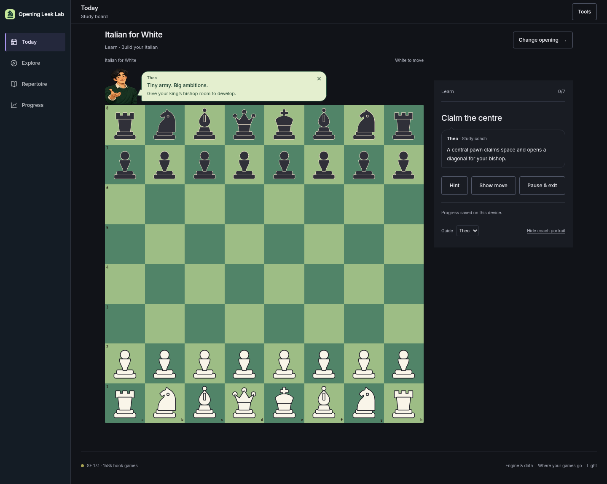
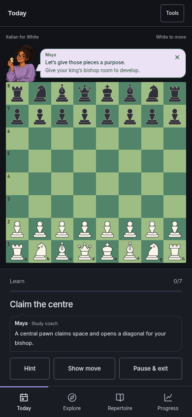
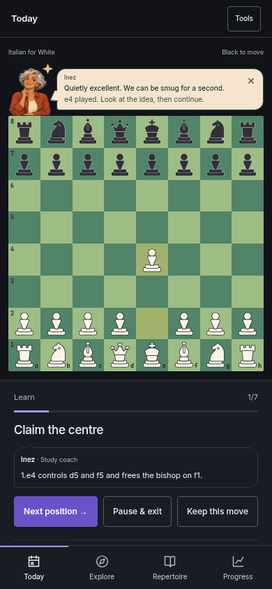
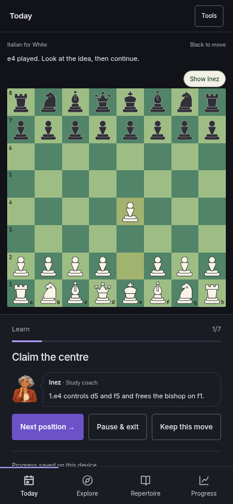

# Board-side characters and speech bubbles

This draft builds on the public-page and artwork work in PR #32. It adds playful
character reactions to the existing boards; production remains unchanged.

## Try it

- On the homepage, play the preview, try a legal alternative, request a hint, and
  play the taught move. The character’s small speech bubble reacts to each step.
- Tap or keyboard-activate the character for another quip. This never reveals
  an answer, changes the board, or writes a learning attempt.
- Open a lesson. Your chosen guide stands at the board’s top edge, with the
  current instruction in a coloured speech bubble. The explanation below uses
  a matching speech-bubble shape, with no duplicate portrait while the board
  character is visible.
- Choose Maya, Theo or Inez in the lesson’s Guide selector. Each has an authored
  voice: warm and witty, enthusiastic, or dry and mischievous. Wrong repertoire
  answers are treated as legal alternatives, not automatically labelled blunders.
- Close the bubble for Quiet mode. The compact “Show [name]” button restores it;
  keyboard focus moves to the visible control. The preference uses the existing
  store. Hiding coach portraits still removes the board character and restores
  the plain instruction.
- Lessons, recall, hints, assisted answers, engine practice, model games and
  connection failures have context-appropriate reactions. Completion screens
  keep the existing session results and compact mobile layout.

## Behaviour and limits

Characters sit on the board frame, above the squares; they never mask playable
pieces. The rail grows with long instructions. Reactions use short, single-play
peek or bounce animations and respect `prefers-reduced-motion`. There is no sound,
automatic speech carousel or timer that dismisses an instruction while reading.

All quips are fixed, authored text. The feature does not generate chess advice,
change grading, write attempts, or alter existing saved lines and schedules. The
original lesson explanations and labelled, verified engine continuations remain
the source of chess instruction. Quiet mode and guide selection are ordinary
preferences, separate from learning records.

## Checks

- 14 focused browser journeys passed: all three voices, keyboard activation,
  preview reactions, White/Black lessons, assisted practice, persistent quiet
  mode, hide/show behaviour, state preservation, reduced motion and layouts at
  360/390/768/1440px.
- Mobile completion checks passed at 360×800 and 390×844.
- 15 axe WCAG A/AA scans passed across the public pages and light/dark lessons
  at 360/390/1440px. Automated scans are not full accessibility certification.
- The complete application regression suite, hosted bundle assembly and
  JavaScript syntax checks also run for the draft.

## Screenshots

| Board-side speech | A small celebration | Quiet mode |
| --- | --- | --- |
|  |  |  |
