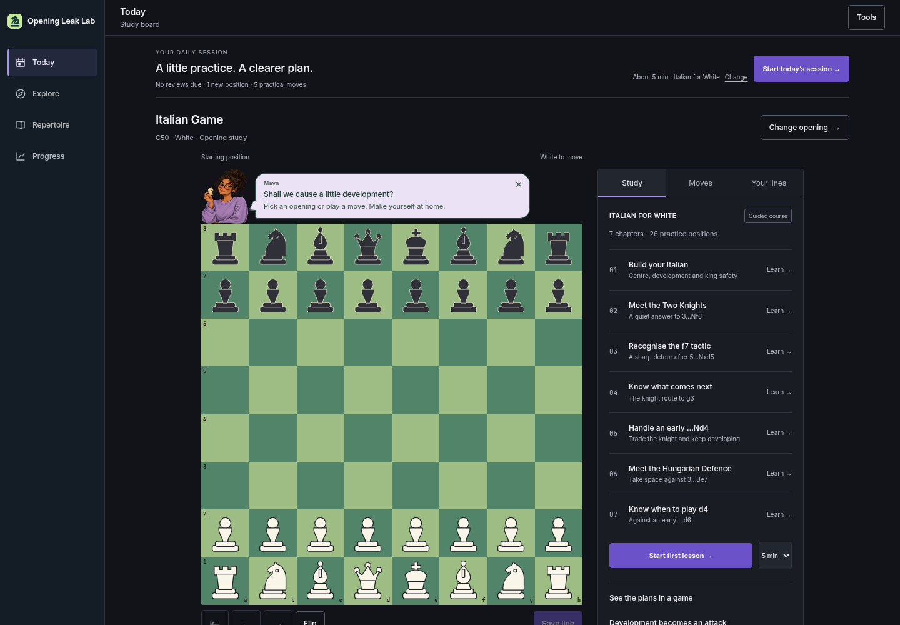
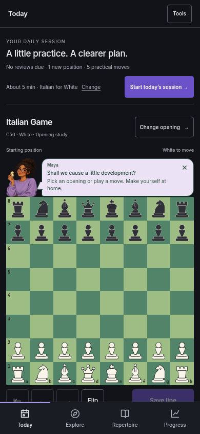
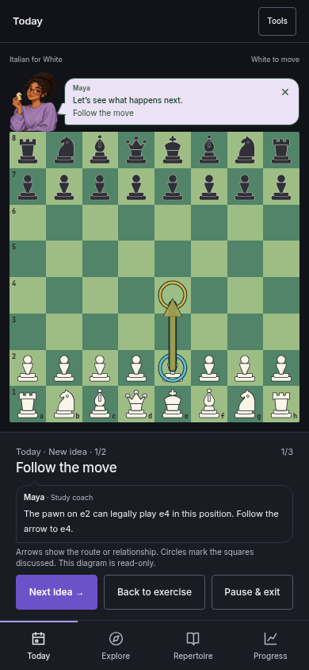
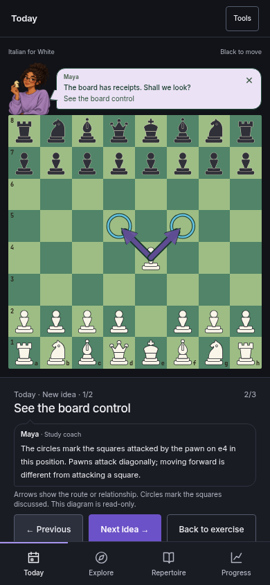
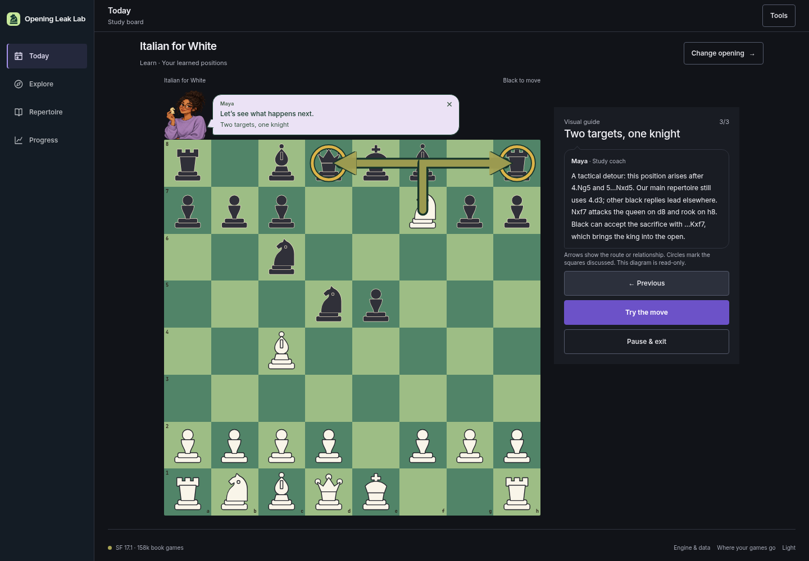
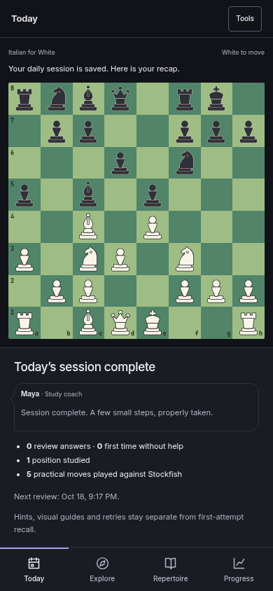

# Daily sessions and visual opening tutorials

The previous three milestones (#31, #32 and #33) are merged into `main` and live.
This draft adds a complete daily routine and visual teaching to that application.
It remains a separate review milestone.

## Try it

1. Open Today. Start a daily session, or use Change to choose about 5, 10 or
   15 minutes and an Italian, Caro–Kann or Queen’s Gambit Declined focus.
2. Existing due positions come first, including personal game preparation.
   The planner selects the oldest due positions across courses, capped at
   3, 6 or 10. It then teaches 1, 2 or 3 unseen positions and ends with five
   learner moves against Stockfish. When there are no unseen positions, the
   learning step is explicitly a refresher. The time is an estimate.
3. In the new idea, follow three board diagrams: the legal move, the squares
   the piece attacks, and the authored opening idea or tactic. Use Previous,
   Next idea and Try the move. Knights use L-shaped routes, castling shows
   both pieces, and the Italian Nxf7 example marks the queen and rook fork.
4. Pause, reload and resume. The exact task, exercise position, teaching
   frame and practical continuation are retained. Existing manual lesson
   checkpoints remain available separately.
5. Complete the practical challenge and open the recap. It reports actual
   review answers, first-attempt answers without help, studied positions,
   practical moves and the next scheduled review. Finish session here also
   works midway through a task; an unavailable engine offers an honest exit.
   Unfinished tasks are never reported as completed. Last recap can reopen
   the result without recording another learning attempt.
6. In an ordinary lesson, use Explore the idea; in recall, use Visual hint.
   Revealing a visual answer makes that recall answer assisted, even after
   closing the diagram or reloading. Browsing diagrams awards no credit.

## Teaching and saved data

All 59 authored course positions have three frames: **177 diagrams**. Positions,
legal moves and attacked squares are compiled with python-chess from the
existing courses. Attack diagrams distinguish pawn movement from attacks and
explain that geometric control does not guarantee a legal capture. Circles on
friendly pieces represent defence. The final explanation reuses the authored
course note; no engine evaluation or new positional verdict is invented.

The shared board supports circles and bent arrows in either orientation, with
dark outlines for contrast and text equivalents for screen readers. Diagrams
are read-only. They do not interfere with playable board squares. The selected
coach continues to react at the board edge, with existing quiet-mode and
reduced-motion preferences.

Daily plans use the existing version-2 learning store, checkpoints and account
mirror. No saved-record migration or deletion is required. Stable task IDs
prevent duplicate credit on resume. Short daily lessons do not mark an entire
authored chapter complete. Independent recall remains separate from lessons,
hints, retries and practical play. Existing account-sync limitations remain:
this does not add an offline upload queue or concurrent checkpoint resolution.

## Validation

- The complete browser regression covers the existing application plus 17 new
  journeys: time budgets, mixed-course review, exact resume, assisted grading,
  real Stockfish completion, engine failure, early finish, manual-checkpoint
  preservation, Black orientation and 360/390/1440px layouts.
- Two compiler tests verify all 177 frames against the real positions, legal
  moves and attacks, including knight routes, castling and reproducible output.
- **36 axe WCAG A/AA scans passed** across Today, expanded settings, move and
  control diagrams, exercises and recap, at 360/390/1440px in light and dark
  themes. Automated scans are not full accessibility certification.
- Hosted bundle assembly and whitespace checks pass. The isolated browser
  server has a larger engine-request allowance so a full release run can
  simulate many sessions; production rate limits are unchanged.
- Full CI totals and the preview link are recorded in the pull request.

## Screenshots

| Start a session | Follow the move | Understand control |
| --- | --- | --- |
|  |  |  |

