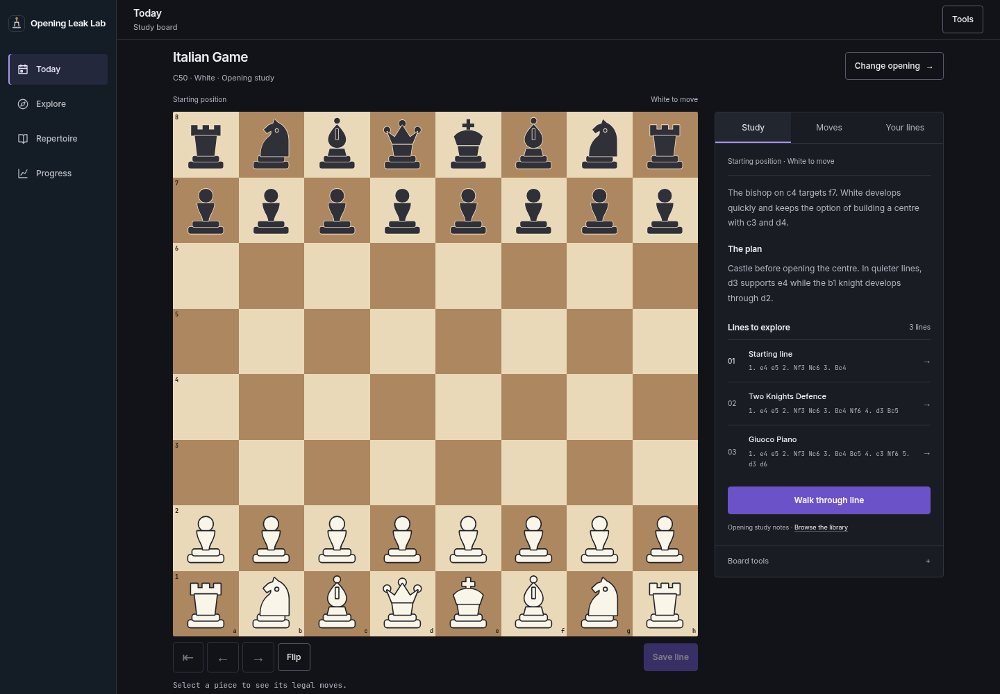
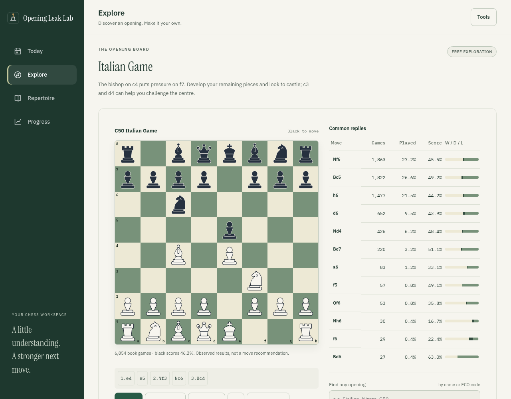
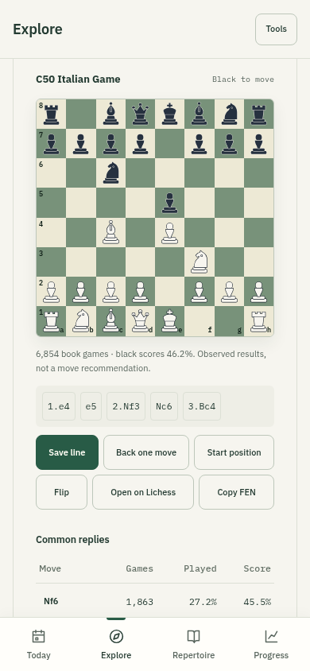
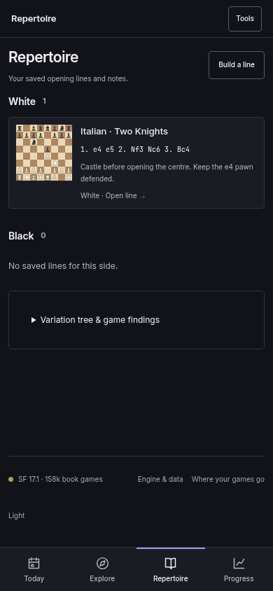

# Foundation milestone: review guide

17 October 2026 · Four-destination interface · Ready for review

This implements the first interface milestone from `chess-learning-build-plan.md`:
Today, Explore, Repertoire and Progress, with opening exploration before importing
games. The existing vanilla JavaScript/Python stack and stable saved-data keys are
retained. No production deployment or next-phase learning programme is included.

## Review the experience

1. Open `/app/` in a clean browser. Today offers exploration with no import or sign-in.
2. Choose Explore → Italian Game. Play a book move or tap a piece and a legal
   destination. Step back, choose an alternative, flip the board and inspect the
   move order. Keyboard users can use the board grid or the book-move buttons.
3. Press **Save line**, choose a side, enter a name/note and save. Follow **See it
   in Repertoire**, reload and reopen the card. Both the side and explored move
   order should survive. The saved choice is the last move played by the selected
   side; the full path remains available for reopening and PGN export.
4. Open Progress. Preparation, practice and game evidence stay separate. A new
   visitor sees useful explanations rather than invented mastery or review counts.
5. Use Tools → Analyse games → sample archive. Existing report filters, charts,
   position review, drills and exports remain accessible. Exit review to its origin.
6. Repeat at 360px, tablet and desktop widths. Use Back/Forward, reload a direct
   link and try SAN/FEN entry. The four labelled phone tabs remain available.

## Screenshots

| Today, desktop | Explore, desktop |
| --- | --- |
|  |  |

| Explore, phone | Repertoire, phone |
| --- | --- |
|  |  |

## Existing behaviour audited

| Area | Finding and treatment |
| --- | --- |
| Navigation | Dashboard/Clinic/Repertoire/Prep were top-level; history replaced every entry. Four primary destinations now use real history, preserving old hashes as aliases. |
| General exploration | `/api/position` and `/api/openings` already worked independently. The library was nested in Repertoire. It now lives in Explore and has recoverable request failures. |
| Personal findings | `summary.explorer` depends on a report. It remains a separate optional game-evidence section on Progress. |
| Preparation | Existing prep editor saves positional choices via `commitPrep`; it remains available under Repertoire → Build a line. |
| Local data | Repertoire, drills, runs, report and preferences retain their keys. Versioning establishes a compatible baseline, with a backup of existing repertoire/drills/runs/preferences. The report remains untouched. |
| Account data | Existing JSON entry storage supports additive metadata. Its whitelist previously discarded `source`; it now retains source, name, notes, starting FEN and explored path. No database migration is needed. |
| Persistence errors | Failed writes previously left an unreadable in-memory fallback when storage existed. Failed writes now remain readable in this tab and are never labelled saved to device. |
| Analysis | Local async jobs, hosted synchronous analysis, import, account gate, demo, charts, CSV, PGN and Lichess exports are retained. |
| Board | Reused legal moves, tap selection, promotion and keyboard control. Added valid grid rows, accessible book buttons, larger SVG pieces and legible coordinates. |

## Validation

- **202 Python tests passed**, including the assembled hosted bundle and real
  PostgreSQL account/state tests. One upstream Starlette/httpx deprecation warning.
- **15 Chromium browser journeys passed**, using the real local chess and book
  APIs. Includes no-games exploration, White/Black save and reopen, notes,
  standard/FEN PGN parsing, legacy state backup, account-gated analysis with guest
  Explore access, browser history, keyboard moves, phone touch and promotion,
  failed requests, storage quota failure, sample analysis and CSV download. The
  existing prep editor also retains names and notes when revisiting a saved choice.
- Layouts checked at **360×800, 390×844, 768×1024 and 1440×1000**, with no
  horizontal document/main overflow. The Today action is visible on the 360px phone.
- Axe WCAG 2 A/AA and 2.1 AA scans of all four main screens at desktop and 360px
  reported no violations after repairing the inherited board grid structure.
  This is automated coverage, not a human screen-reader usability study.
- `vercel/prepare.py` assembled the deployable bundle, including all new assets.
  JavaScript syntax and `git diff --check` passed.

The book inspected locally is 19.3 MB, with 155 generated opening-family pages.
Statistics remain observations from that book; guides do not invent game examples
or imply that a popular move is necessarily best. No unsupported dataset filters
or full-game archive are presented.

## Scope boundary for the next review

This milestone provides exploration and saved positional choices. It does not
claim to deliver reviewed chapters, a guided lesson session, independent recall,
a daily training queue, scope-based preparedness, XP or weekly goals. Existing
engine-graded drills remain secondary tools and their historical results are
labelled as practice, not independent recall. Account merge/conflict behaviour is
unchanged; durable sync still requires the existing configured account backend.

The next phase should begin only after this interface is reviewed. Human chess
content review and representative-user testing remain part of the build plan.
