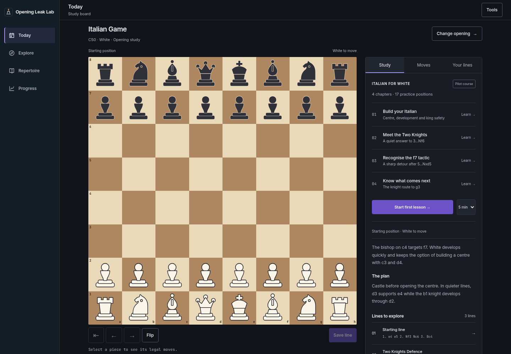
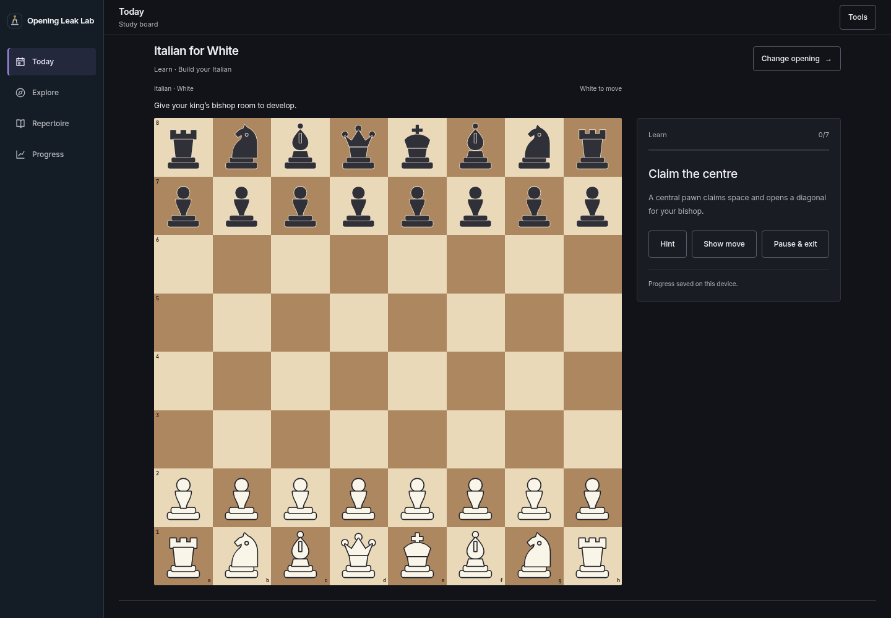
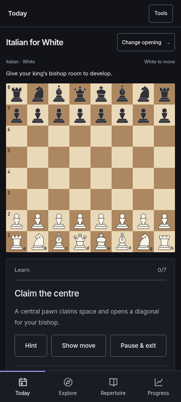
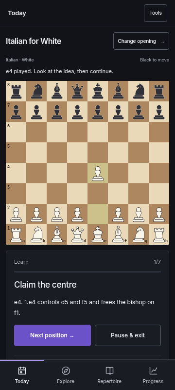
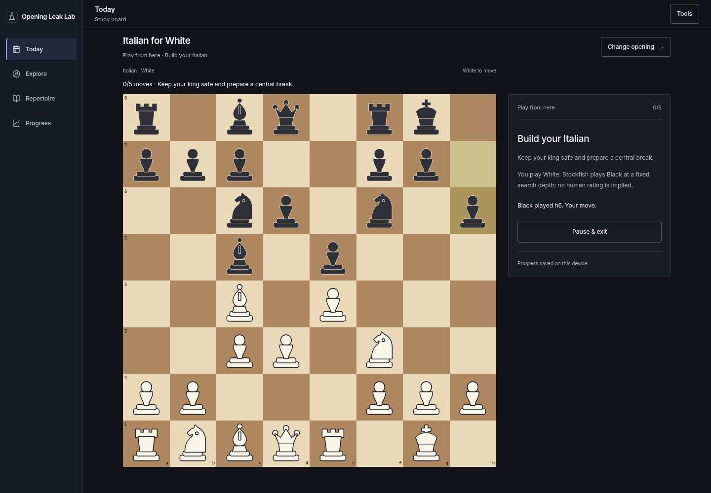

# Italian training: v2 review

17 October 2026 · First v2 increment · Review before expanding the curriculum

The Italian opening now has a complete learn → recall → play loop on the existing
board. No account or game import is needed. Today, Explore, Repertoire and
Progress remain the four destinations; the opening library and analysis tools
remain available.

## Try it

1. Open `/app/`. In the Study panel choose **Build your Italian**. Play e4, Nf3,
   Bc4 and the remaining prompts. Feedback explains each move on the same board.
2. Try a different legal choice. The position stays in place, and the explanation
   distinguishes a missed repertoire answer from a chess mistake. Two misses
   reveal the intended move rather than trapping the player in retries.
3. Pause, change opening or reload. **Resume** restores the current task, hints,
   first submitted move and completed answer. Starting another chapter keeps
   the earlier checkpoint available.
4. Finish a chapter. **Save course line** adds its actual path to Repertoire;
   repeating the save preserves an existing committed response's name and notes.
   Export it through the existing PGN tools.
5. Choose **Practise without hints**. The board prompt and panel hide the answer.
   Hints, reveals and retries never receive independent-recall credit. Reloading
   a completed answer cannot award it twice.
6. Choose **Play from here** at chapter completion, or from its completed row in
   the course. Stockfish plays Black from that chapter's final position. Play
   five White moves; pause and resume in between. This is practice without a
   pass/fail score or an implied human opponent rating.
7. Visit Progress. Introduced positions, first-time unassisted recall attempts
   over 30 days, review dates and completed practical sessions appear separately.

## Content and scheduling

Four original pilot chapters cover 17 White-to-move positions:

| Chapter | Positions | Scope |
| --- | ---: | --- |
| Build your Italian | 7 | e4, development, the c3/d3 structure, castling and Re1 |
| Meet the Two Knights | 3 | A quiet 4.d3 response and a transposition into the main structure |
| Recognise the f7 tactic | 3 | The specific 4.Ng5 d5 5.exd5 Nxd5 tactical detour |
| Know what comes next | 4 | Preserving the bishop and the Nb1–d2–f1–g3 route |

Lessons enrol positions for review after one day. Due positions answered first
time without help use intervals of 1, 3, 7, 14 and 30 days. Hinted answers return
after four hours; misses and reveals after ten minutes. Early independent
practice leaves the existing due date intact. A 5/10/15-minute preference caps
reviews at 6/12/17 positions; these are approximate session sizes, not timers.

The existing 20 reference guides and 60 lines remain browsable. This pilot is
not an exhaustive Italian repertoire: the Two Knights chapter chooses 4.d3,
while the f7 chapter explicitly identifies its separate sharp move order.
The original instructional notes have legality, tactical-claim and engine
checks; a qualified human chess editorial review is still recommended before
presenting the material as an expert-reviewed course.

## Data and failure handling

- Existing repertoire, notes, reports, drills, runs and appearance preferences
  retain their formats. Normal exploration uses the same board instance and
  restores its previous position after training.
- Learning uses namespaced account records through the existing preference
  transport. Attempts, enrolments and completions are immutable on the server;
  checkpoints have unique session IDs and ordered writes within a browser.
- Guest learning joins existing account records without replacing account
  repertoire or another session's checkpoint. Sign-out clears the local learning
  copy. Existing export/delete account handling includes these preference records.
- Storage failures retain the tab copy and display an accurate warning. API
  failures preserve the current question. Engine failures keep the White move
  already played and offer retry or exit. Leaving cancels late UI updates.
- Lessons and recall use the legal-position API; they do not call Stockfish.
  Practical play uses the existing server engine at depth 10. Availability and
  response times depend on that service. Existing account sync remains a write
  mirror; simultaneous editing of one checkpoint across devices is not a live
  collaboration feature, and offline writes are not a durable server outbox.

## Validation

- **208 Python tests passed**, including real PostgreSQL account state and
  immutable learning evidence, all curriculum positions, the Two Knights
  transposition and the f7 tactical claims.
- **37 browser journeys passed** with the real local chess API, including
  all four chapters, real Stockfish play, scheduling, early reviews, reloads,
  assisted answers, bounded retries, request/engine/storage failures, account
  adoption, PGN exports and the 18 existing release journeys.
- Training layouts checked at 360×800, 390×844, 768×1024 and 1440×1000, using
  touch and keyboard input. The phone board remains full width; primary controls
  fit above bottom navigation in the tested initial and answered positions.
- **20 axe scans reported no WCAG A/AA violations**: overview, lesson, hint,
  answered position and Progress at desktop and 360px, in light and dark themes.
  These automated scans do not establish complete accessibility conformance.
- Stockfish 17.1 depth-16 spot checks of all 17 intended moves found no material
  evaluation concessions at that search depth; engine checks do not establish
  instructional completeness or replace human review.
- Hosted bundle assembly, JavaScript syntax and whitespace checks passed.

## Screenshots

| Course and board | Guided lesson |
| --- | --- |
|  |  |

| Phone lesson | Phone feedback |
| --- | --- |
|  |  |

This increment is ready for review. Further openings, richer model games,
preparedness scoring and personal-game recommendations remain subsequent work.
