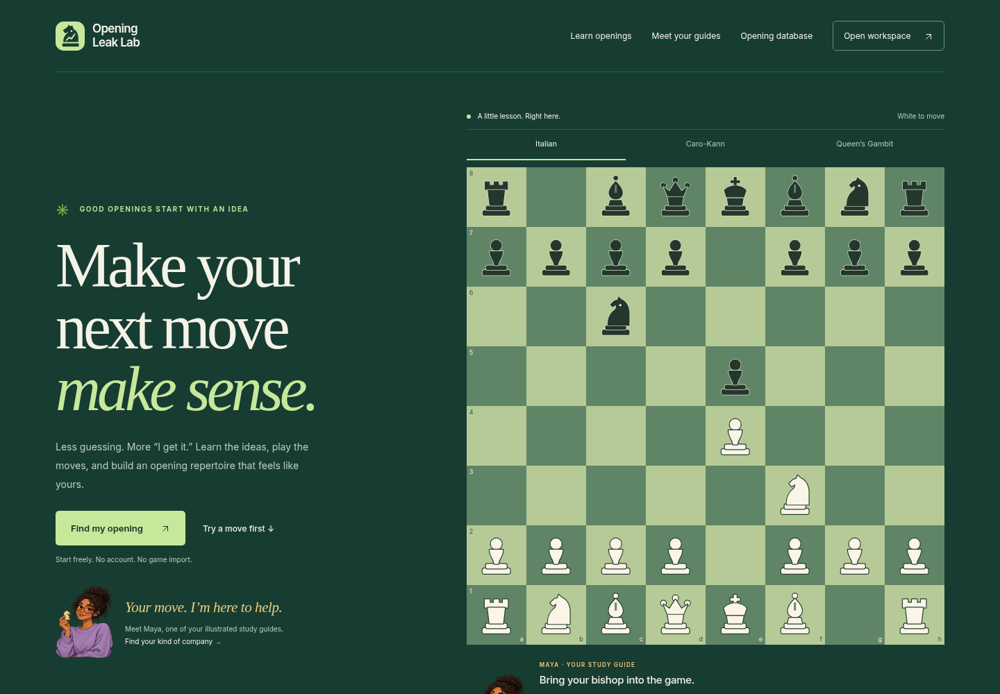
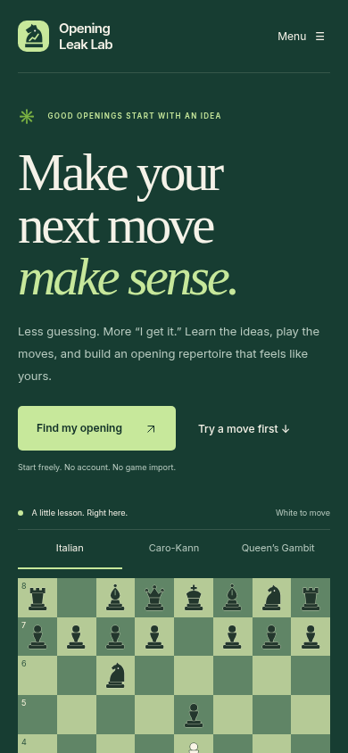
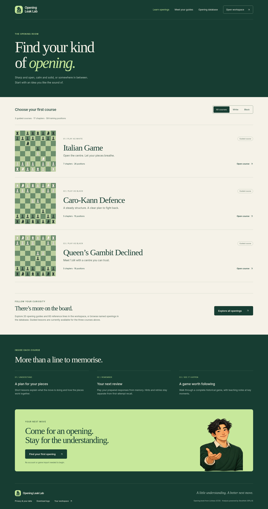
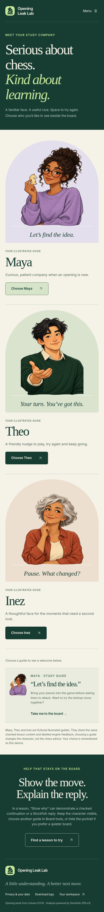
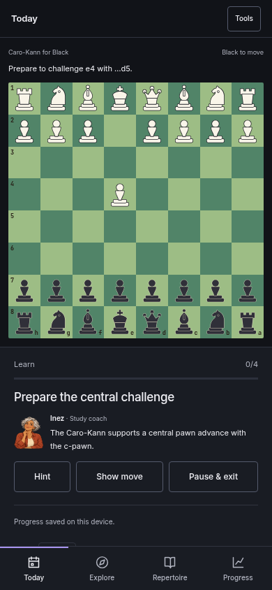

# Public pages, logo and illustrated guides

This draft builds on the opening-training milestone in PR #31. It adds three
public pages and brings their visual identity into the existing workspace.
Production is unchanged.

## Try the experience

1. Open `/`. Play Bc4 on the large board, switch to a Black opening, ask for a
   hint, try a legal alternative and reset. These previews run locally and never
   create training attempts or change saved learning progress.
2. Open `/learn/`. Filter White or Black, then open a course. Its link selects
   that opening in the workspace, including the correct board orientation.
3. Open `/coaches/`. Choose Maya, Theo or Inez. Follow the link into a lesson;
   your selection appears alongside the board. Change it in the lesson’s Guide
   selector, or in Board tools when exploring. The existing hide-portrait
   preference still works.
4. The homepage’s optional game-analysis form still passes the selected provider
   and username to the established analysis flow. The sample report, PGN import,
   privacy dialog and opening database remain linked.

## Design and assets

- Forest green, warm cream, soft lime and restrained gold. Large serif headlines,
  local Inter fonts, flat course rows and an interactive green board; no external
  font requests or new runtime dependencies.
- Original knight logo with a rising move path: SVG icon and horizontal logo,
  shared favicon/app mark and a PNG social preview. A logo download is in the
  footer. The existing product name remains Opening Leak Lab.
- Original generated artwork for Maya, Theo and Inez, delivered as one 295 KB
  WebP. CSS displays the individual characters without fetching separate large
  images. The asset’s provenance is in `public/assets/brand/README.md`.
- The characters are fictional illustrated guides. Their welcome messages differ;
  all use the same authored lessons and checked, labelled engine explanations.
  No invented chess qualifications or live human coaching claims.
- Coach choice uses the existing preferences store and account write transport;
  guests retain the choice on this device when storage is available. If storage
  is blocked, the page clearly limits the choice to that visit.
- Public lesson legal moves and FENs are compiled from the existing course
  content, validated against python-chess, and use the existing accessible board.
  A legal alternative is described as legal rather than falsely called a blunder.

## Validation

- **89 browser journeys passed**, including 22 new public-page journeys and the
  existing 67 application journeys.
- **15 axe scans passed**: three public pages and two lesson themes at each of
  360, 390 and 1440 pixels.
- **7 targeted Python checks passed** for public-preview legality and opening-page
  generation; the complete backend suite also runs in GitHub CI.

- Public journeys cover 360/390px phones and desktop, both board orientations,
  keyboard moves, hints/retries, exact course counts, deep links, character
  persistence, storage failure, navigation and provider handoff.
- Regression checks include the existing learning, recall, repertoire, model-game,
  game-report and saved-data journeys.
- Axe checks cover all three public pages at 360/390/1440px and the updated lesson
  in light and dark themes. No WCAG A/AA violations in those automated checks;
  this is not a claim of full accessibility certification.
- Hosted bundle assembly, preview chess legality, generated sitemap and JavaScript
  syntax are checked. The sitemap includes both new public destinations.

## Screenshots

| Phone home | Course browser | Choose a guide |
| --- | --- | --- |
|  |  |  |

