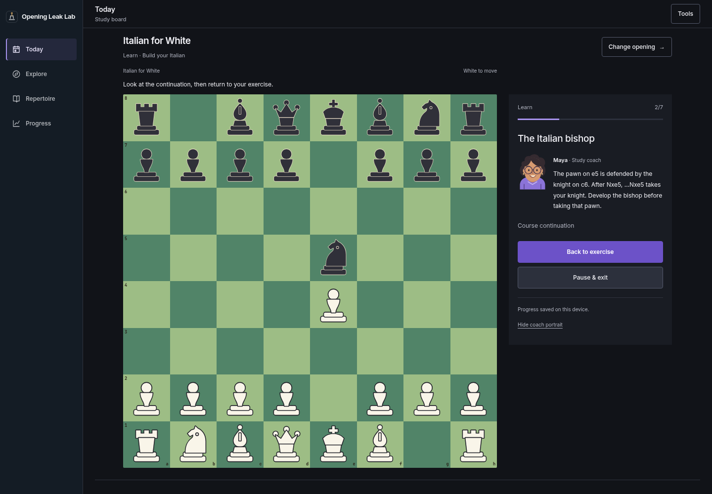
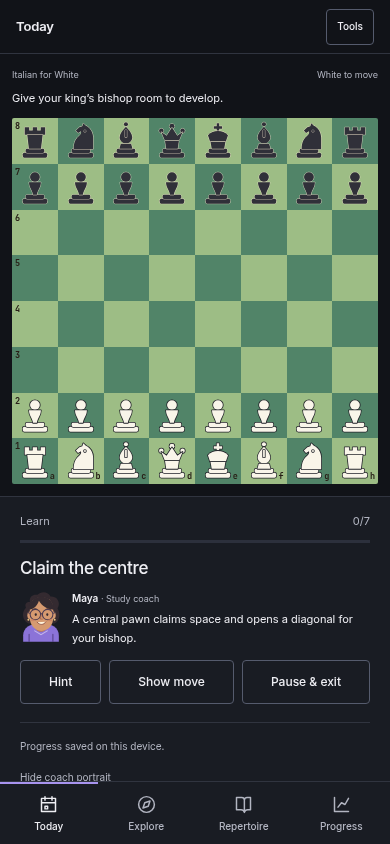
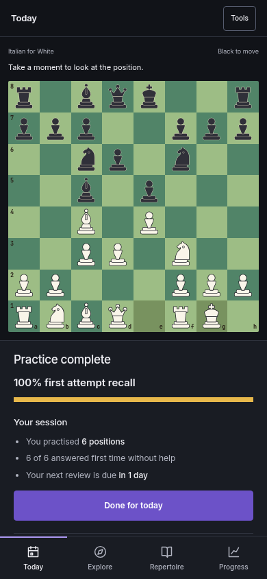
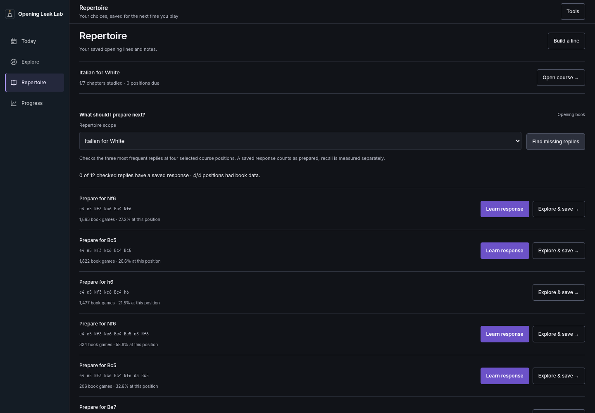
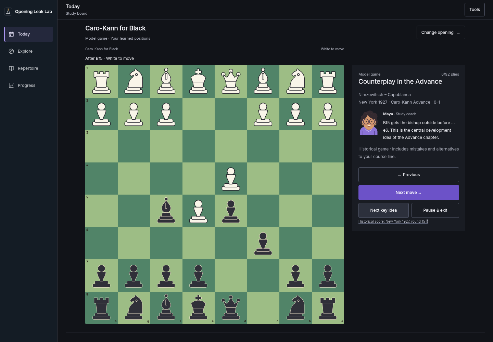

# Opening courses and coach: v2 review

17 October 2026 · Expanded draft PR #31 · Review before production merge

The learning workspace now includes deeper Italian material, two Black starter
repertoires, an illustrated coach, historical model games, preparation gaps from
the opening book and exercises from personal game reports. Everything runs on the
existing board within Today, Explore, Repertoire and Progress.

## Design and the coach

The latest Chessbook reference informed the classic green board, flat dark study
panel and compact mobile review summary. On phones the board comes first, with
the explanation and controls directly below it. The review summary shows actual
first-attempt recall, the number of positions practised and the next review date.
It does not convert this session's result into an overall mastery estimate.

Warm wood remains available in Board tools. Board style, theme and the option to
hide the coach portrait persist. Existing appearance preferences are retained.

Maya is an original SVG character, not a real person or a claimed titled player.
Her explanations come from original course notes, checked teaching continuations
or explicitly labelled Stockfish comparisons. She distinguishes an alternative
repertoire choice from a tactical mistake. **Show why** checks a concrete reply;
**Play the continuation** demonstrates it without awarding recall credit.
An unavailable engine leaves hints and the ordinary course usable.

## Content included

| Course | Chapters | Training positions | Scope |
| --- | ---: | ---: | --- |
| Italian for White | 7 | 26 | Quiet Italian, Two Knights, f7 tactics, typical knight regrouping, early …Nd4, Hungarian Defence and the d4 break |
| Caro-Kann for Black | 5 | 15 | Central challenge, Classical bishop development, Advance, Exchange, bishop safety and a loose-bishop tactic |
| Queen's Gambit Declined for Black | 5 | 18 | Solid development, Exchange structure, Orthodox exchanges, …e5 counterplay and the Elephant Trap |

These are 59 training positions across 17 chapters. They are starter repertoires
with stated scopes, not responses to every possible move order. The existing
20 reference guides and their 60 lines remain available. The original Italian
course ID, position IDs, four chapters and answers remain compatible with saved
learning records. New material does not reset previous progress.

Each course includes a complete historical model game, with original teaching
notes at key positions, move-by-move replay, key-position navigation and resume:

- [Anderssen–Dufresne, 1852](https://en.wikipedia.org/wiki/Evergreen_Game):
  development and initiative in the Evans Gambit; explicitly distinguished from
  the course's quiet main line.
- [Nimzowitsch–Capablanca, New York 1927](https://lichess.org/study/b348TvNH/AwD0Yp1g):
  the Caro-Kann Advance, …c5 and active piece play.
- [Capablanca–Lasker, 1921 championship, game 11](https://www.schachsinn.de/view/d63_queensgambit33.htm):
  why Black needs counterplay in the QGD; the replay includes Black's loss.

Only historical move scores are used from these sources. Modern source
annotations are not reproduced. Historical games include mistakes and lines
outside the chosen repertoire; replaying them is not graded recall. Original
instructional content remains suitable for human chess editorial review before
being marketed as an expert-reviewed course.

## Try the full flow

1. From Explore choose Italian, Caro-Kann or Queen's Gambit Declined. Start a
   chapter without importing games or creating an account. Black training puts
   Black at the bottom of the board.
2. Play a different legal move. Maya explains the course's choice without calling
   every alternative a blunder. In Italian's bishop lesson, try **Nxe5** and
   choose **Show why**, then **Play the continuation**: …Nxe5 captures the knight.
   Return to the exercise with the previous attempt intact.
3. Finish a chapter and practise without hints. Hinted, missed and revealed
   answers remain separate from independent recall. Old review intervals and
   stable attempt IDs are retained. The session summary shows its actual results.
4. Use **Keep this move** after answering a lesson, or **Save course line** at
   completion. Existing names and notes survive repeat saves. PGN exports retain
   the legal path and starting FEN where needed.
5. Start **Play from here**. Stockfish plays the opposite side. Five learner moves
   complete the practical session. Reloading during a Black session restores
   both the side and the moves already played; Today offers to resume it.
6. Open a model game and use **Next key idea**. Pause and reload, then resume at
   the same position. No recall credit is awarded for replay.
7. In Repertoire choose **Find missing replies**. The check uses the three most
   frequent book replies at four selected positions in that course, and reports
   how many checked replies have a saved response. Learn an available response
   or **Explore & save**, then check again. Scope, samples and unavailable data
   remain visible; there is no invented global coverage percentage.
8. Analyse imported games through the existing tools, then visit Progress. A
   finding can become a checked, saved exercise. **Explain my game move** uses
   its actual played move. The sample archive is labelled separately. Invalid
   report answers are rejected rather than turned into exercises.

## Preservation and practical limits

Learning remains namespaced by course through the existing account transport;
the default Italian namespace is unchanged. Game exercises have their own
namespace and immutable source records. Account import, sign-out, exports and
deletion use the existing mechanisms. No database schema migration is required.

The ordinary opening board, analysis, earlier drills, saved responses, notes and
exports remain available. Lessons and recall use the legal-position API without
a live engine. Stockfish is required for sparring and comparisons that do not
have an authored continuation. Engine failures preserve the current exercise.

Preparation checks describe selected positions in the bundled opening book;
they have no rating/time-control filters and do not measure recall or results in
games. Findings come from the latest analysis; saved exercises remain available
after a newer report. Account sync remains a write mirror, without live conflict
resolution for simultaneous editing of one checkpoint or a durable offline outbox.

Both local and hosted APIs now keep one SQLite book connection per worker thread.
Concurrent preparation scans and board previews no longer share a statement cache.

## Validation

- **213 Python tests passed**, including real PostgreSQL account tests, immutable
  game-exercise records, all course positions and anchors, historical move scores,
  the original Italian compatibility check and the Elephant Trap material count.
- **67 browser journeys passed** across the existing application and expanded
  flows: all new chapters, both training colours, real Stockfish sparring and
  explanation, coach continuations, resume, model games, scoped preparation,
  personal exercises, source labels, invalid responses, service failures and concurrent opening-book requests.
- **20 WCAG A/AA axe scans passed** across course, lesson, review summary,
  preparation and model-game screens, at desktop and phone widths in both themes.
  An additional 360px lesson scan passed. Automated scans are not full human
  accessibility certification.
- Stockfish 17.1 depth-14 checks of the 42 additional positions found a maximum
  difference of 0.33 pawns from its preferred move at that search depth. Original
  Italian moves retained their prior checks. This does not establish completeness
  or replace human editorial review.
- JavaScript syntax, hosted bundle assembly and whitespace checks passed.

## Screenshots

| Coach explains a concrete mistake | Board-first phone lesson |
| --- | --- |
|  |  |

| Actual review results | Missing replies from the book |
| --- | --- |
|  |  |

