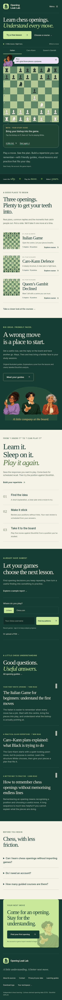
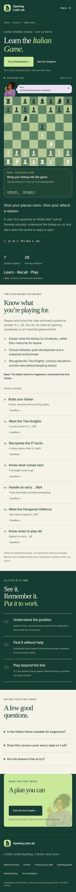
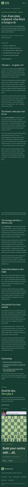
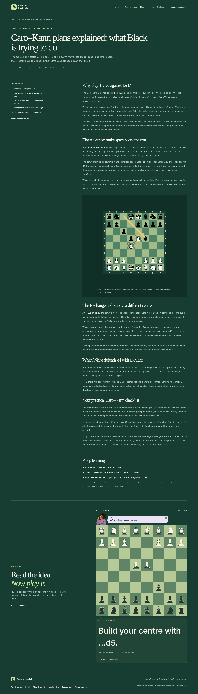

# Public website and search release

This review builds on PR #34’s daily sessions and visual lessons. It adds the
public learning and search experience; both drafts remain reviewable separately.

## Try the site

- `/`: the interactive board is the first experience, with a clear “Try a free
  lesson” action. On a phone, supporting copy follows the board rather than
  pushing it below a long introduction. The optional game-analysis form remains.
- `/learn/italian-game/`, `/learn/caro-kann/` and
  `/learn/queens-gambit-declined/`: a playable example, suitability, learning
  outcomes, the actual course curriculum, common questions and a first-chapter
  link. Every chapter link resumes an existing checkpoint when present.
- `/guides/`: three substantial learning guides, each with a table of contents,
  annotated board, source/method link, related reading and a free exercise:
  Italian Game for beginners, Caro–Kann plans, and remembering chess openings.
- `/about/`, `/contact/` and `/privacy/`: project identity, chess-content sources,
  correction reporting, real account-data controls and optional measurement.
  Contact links to the actual public project issue tracker; no invented mailbox
  or unconnected contact form is presented.
- `/openings/`: the existing data-backed opening pages now share the current
  navigation, typography, footer and course links. Their selection thresholds
  are preserved. Copy distinguishes observed scores from engine evaluations.
- A missing URL returns an actual 404 with useful course/workspace links.

Public exercises run without the API, account or engine and create no learning
attempts. Static diagrams and all article text are available without JavaScript.
The existing saved repertoire, lessons, preferences and game-analysis flows are
preserved. The app also has a direct, validated chapter hand-off from the site.

## Search and performance

- Crawlable HTML, one H1 per page, unique titles/descriptions, production
  canonical URLs and complete social metadata. Structured data describes the
  website, project, course, article and breadcrumbs; there are no invented
  reviews, ratings, titles or search-result promises.
- The sitemap contains **169 URLs** with this book: 13 fixed public destinations,
  the database index and 155 well-sampled opening positions. The app, API and
  error page are excluded. The app has `noindex` in HTML and hosting headers;
  it stays crawlable so search engines can read that instruction.
- Preview builds get `noindex` while canonical URLs point at the real domain.
  Search Console verification is supported as a build setting rather than a
  fake token checked into source.
- Public pages load a tiny course summary instead of the complete training
  curriculum. Board previews use compiled legal moves and never start Stockfish.
  Static SVG fallbacks reserve board space. Local fonts use swap, and hosting
  cache rules cover artwork and fonts. Hosting already delivers text compression.
- Early menu enhancement prevents the no-JavaScript menu from causing a large
  layout jump during page load. Decorative board coordinates retain the
  accessible square label and the same visual placement.

## Measurement

`metrics.js` emits a small allowlist of coarse public/learning events. It sends
nothing externally by default. Activating Plausible requires the operator’s
account and build setting, then an explicit visitor choice on the Privacy page.
GPC and DNT override that choice. Preview/local deployments never submit events.

Events discard query strings, fragments, chess handles, account/session IDs,
emails, game moves, FENs and arbitrary extra fields. The optional provider still
receives normal network information when a visitor allows a request. The old
automatically loaded workspace analytics script is removed, and the in-app
privacy dialog links to the full policy. Its outdated sign-in-token wording is
corrected to match the current implementation, which does not retain that token.

See [Search Console and measurement setup](search-and-measurement-setup.md) for
the account-specific activation and post-release checks.

## Validation

Six new backend checks cover metadata, internal links, course/schema consistency,
substantial article content, legal static diagrams, build reproducibility,
sitemap privacy, verification-token validation and preview indexing rules.
New browser journeys cover public layouts, offline lessons, chapter hand-off and
resume, no-JavaScript reading/navigation, missing-page recovery, database tables
and optional measurement with privacy protections.

The pull request records the final full-suite totals, accessibility scans,
mobile Lighthouse results and deployed preview link. Lab measurements are not
field Core Web Vitals or a guarantee of search rankings.

## Screenshots

| Phone homepage | Public course | Beginner guide |
| --- | --- | --- |
|  |  |  |

